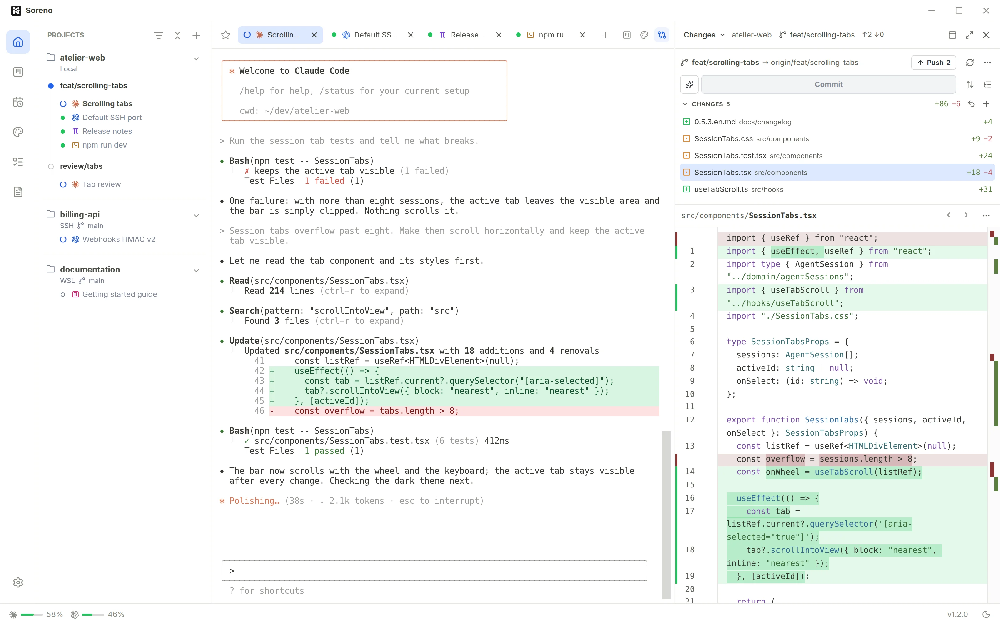
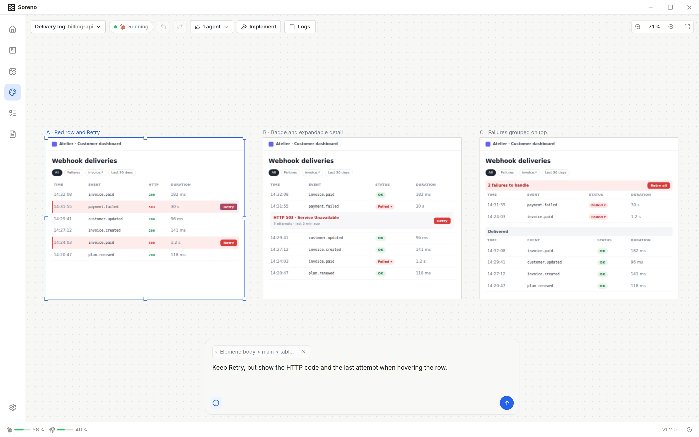
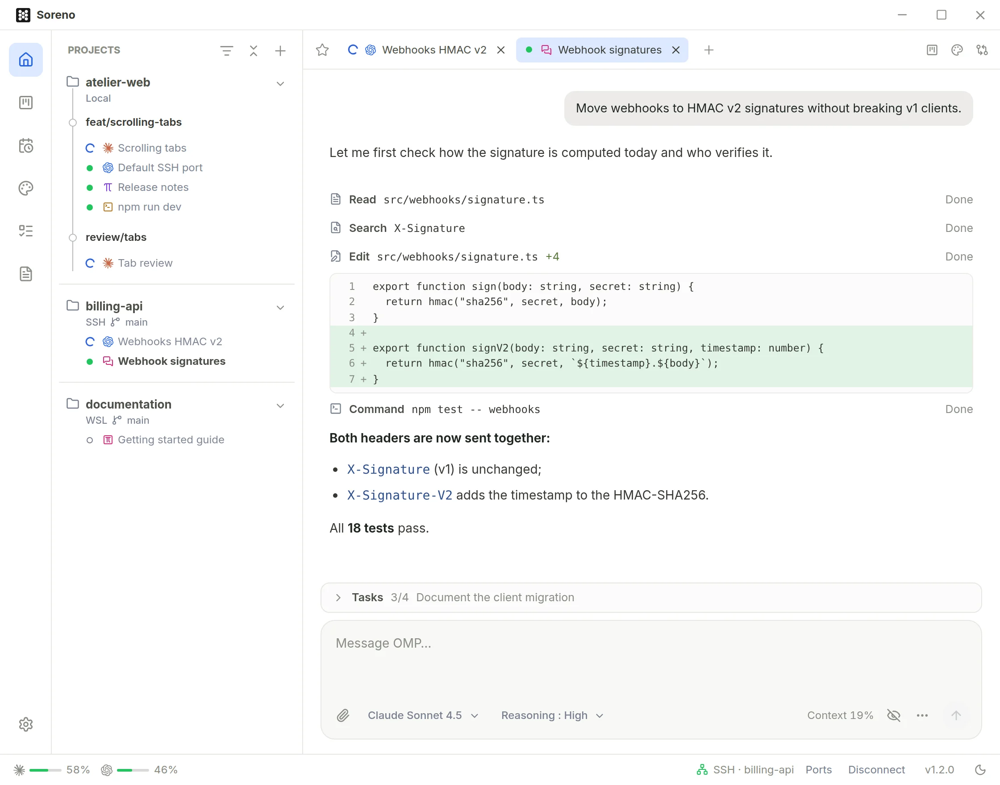

# Soreno

Desktop app for Windows, macOS and Linux that combines note-taking with a
workspace for CLI agents (Pi, OMP, Codex, Claude Code), built with Tauri 2,
React, TypeScript, Rust and SQLite. Notes stay in local vaults.

Website: <https://www.soreno.dev>

<picture>
  <source media="(prefers-color-scheme: dark)" srcset="docs/screenshots/agents-dark.webp">
  
</picture>

## Getting started

Install Node.js at the version in [`.nvmrc`](.nvmrc), npm, Rust/Cargo via
[rustup](https://rustup.rs/), then the
[Tauri prerequisites](https://v2.tauri.app/start/prerequisites/) for your OS (C++
build tools and WebView2 on Windows, Xcode on macOS, WebKitGTK 4.1 on Linux:
`libwebkit2gtk-4.1-dev libxdo-dev libssl-dev librsvg2-dev` on Debian or Ubuntu).
From the root of the clone, in a native terminal:

```sh
npm ci
npm run tauri -- dev
```

`npm run dev` (or `npm run build && npm run preview`) only serves the frontend
in a browser: SQLite storage, attachments, Codex and agent sessions require the
app. Commands suffixed with `:windows` are for Windows development from WSL.

## Native builds

- **Windows**: `npm run tauri -- build`, artifacts in `src-tauri/target/release/`
  (installers under `bundle/`).
- **macOS**: `rustup target add aarch64-apple-darwin x86_64-apple-darwin`, then
  `npm run build:mac` (universal `.app` and `.dmg` in
  `src-tauri/target/universal-apple-darwin/release/bundle/`). These local builds
  are ad hoc signed, without notarization: macOS asks you to allow them
  explicitly.
- **Linux**: `npm run build:linux`, AppImage, `.deb` and `.rpm` in
  `src-tauri/target/release/bundle/`.

## Installing on Linux

Releases ship an AppImage, a `.deb` and an `.rpm` for x86_64, built on
Ubuntu 22.04: they need at least glibc 2.35 and WebKitGTK 4.1 (Ubuntu 22.04,
Debian 12, Fedora 39 or newer). The `.deb` and `.rpm` install these dependencies
and use the system WebKitGTK; the AppImage bundles its own, which can fail on a
graphics stack far from Ubuntu's (on Fedora, prefer the `.rpm`). Run the
AppImage after `chmod +x` (install `libfuse2` if it asks for FUSE). All three
formats update automatically; for the `.deb` and `.rpm`, installing the update
asks for the administrator password.

- **Keyring**: the Linear API key is stored in the Secret Service keyring
  (GNOME Keyring, or KWallet with Secret Service enabled). Without an accessible
  keyring, connecting to Linear fails with an explicit message; nothing is
  written elsewhere.
- **Notifications**: desktop notification service
  (`org.freedesktop.Notifications`).
- **NVIDIA on Wayland**: if the window stays blank or flickers, launch Soreno
  with `WEBKIT_DISABLE_DMABUF_RENDERER=1` (known WebKitGTK workaround).

## Local data

The profile is stored in `%APPDATA%\com.soreno.notes` (Windows),
`~/Library/Application Support/com.soreno.notes` (macOS) or
`~/.local/share/com.soreno.notes` (Linux).

## Features

- **Notes**: CodeMirror 6 editor with two modes, **Markdown source** and
  **Live preview**, on the same document (switching never rewrites spaces or
  blank lines). The formatting toolbar and `/` on an empty line insert Markdown
  syntax; images can be picked, pasted or dropped. No Obsidian-specific plugin
  or format is required.
- **Agents**: Pi, OMP, Codex, Claude Code or **Terminal** projects and sessions
  in built-in terminals, locally, in a WSL distribution (from Windows) or on an
  SSH server. No session starts on its own: a click launches it and resumes the
  linked conversation. A **Chat (OMP)** session shows OMP without a terminal.
- **Design**: whiteboard where Claude Code, Codex or OMP draws HTML/CSS screens
  in the background from a prompt; frames can be moved, duplicated and targeted
  for a revision.
- **Codex updates**: **Settings → AI** checks the Codex installation and offers
  **Update to** the latest version for a recognized npm or Homebrew install;
  otherwise, use its original package manager.

<picture>
  <source media="(prefers-color-scheme: dark)" srcset="docs/screenshots/design-dark.webp">
  
</picture>

<picture>
  <source media="(prefers-color-scheme: dark)" srcset="docs/screenshots/chat-dark.webp">
  
</picture>

## Contributing

See [CONTRIBUTING.md](CONTRIBUTING.md).

## License

Soreno's code is released under the [MIT](LICENSE) license. Third-party
components keep their own: dtach (GPL-2.0 or later, sources and patch in
`src-tauri/dtach/`), ConPTY (MIT, `src-tauri/conpty/`) and those listed in
[`public/third-party-notices.txt`](public/third-party-notices.txt).
